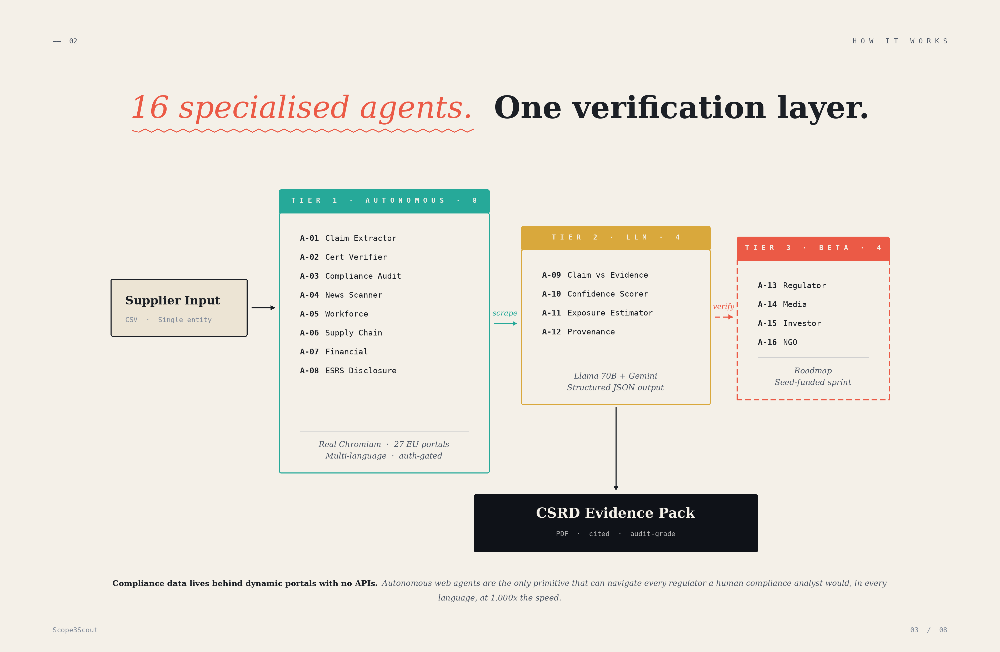

# Scope3Scout

<p align="center"><strong>Autonomous ESG supply-chain verification for the CSRD era.</strong></p>

<p align="center">
  <em>We don't trust supplier reports  -  we verify them against independent public evidence using autonomous browser agents.</em>
</p>

<p align="center">
  <a href="https://scope3-scout.vercel.app/"></a>
  
  
  
</p>

---

## Overview

Scope3Scout is a research and engineering prototype for automated human-rights and environmental due-diligence (HREDD) verification in global supply chains. It runs a pipeline of sixteen autonomous agents that ingest supplier claims, retrieve independent public evidence, and surface contradictions with a confidence score, a financial-exposure estimate, a time-to-impact prediction, and a source link.

The system is the reference implementation discussed in the position paper *"Seeing Like a Dashboard: Digitalized Due Diligence, Legibility, and the Limits of Automated Human Rights Assurance in the EU's Twin Transition"* (GlobalSouthAI @ NeurIPS 2026). The paper uses the architecture below to argue that automated due diligence can only observe what is machine-legible, while the gravest harms resist becoming data.

---

## The problem

Under the EU Corporate Sustainability Reporting Directive (CSRD), 50,000+ European companies are required to verify the environmental and social conduct of every supplier in their value chain, with fines reaching 10% of annual turnover. Three things make this hard today:

1. **ESG compliance data has no APIs.** It lives behind dynamic, JavaScript-rendered government portals across 27 EU member states.
2. **Current solutions are either manual or blind.** Consulting firms charge €100–500K per one-time audit; ESG SaaS platforms trust self-reported data without independent verification.
3. **The regulatory window is closing.** Enforcement ramps through 2026–2027, and companies need continuous verification rather than annual reports.

Scope3Scout targets what currently takes compliance teams months and six figures in analyst fees, using autonomous browser agents to check supplier claims against real-world evidence.

---

## Product

Select a supplier, run an audit, and watch sixteen agents scan public sources, extract claims, verify certifications against registries, and surface contradictions in real time. When a supplier's claim conflicts with public evidence, the system raises a **contradiction alert**:

| Supplier claim | Evidence found |
|---|---|
| *"ISO 14001 certified, audited annually."* | Certificate expired 14 months ago; no renewal on file with the ISO registry. |
| Source: `supplier-co.com/sustainability` | Source: `iso.org/certificate-search` |

with a risk assessment attached (example values):

| Confidence | Financial exposure | Time to impact | Risk tier |
|:---:|:---:|:---:|:---:|
| 94% | €2.4M | ~45 days | CRITICAL |

**[Try the live product →](https://scope3-scout.vercel.app/)**

---

## Architecture

<p align="center">
  
</p>

The sixteen agents run as a staged pipeline: questionnaire ingestion and validation, entity resolution across supplier records, ESG-metric normalization, spend-based risk imputation, cross-referencing for discrepancy detection, and risk aggregation and scoring. The agents reason over three classes of machine-legible input: supplier self-reported questionnaires, structured ESG disclosures, and spend-based proxies derived from procurement records.

---

## Data access

Much of the evidence Scope3Scout checks against lives behind portals with no public API, rendered client-side and scattered across 27 member states. The system reaches these through a commercial browser-automation layer — the TinyFish Web Agent API, used under permission — which navigates portals the way a human analyst would:

| Data source | Public API? | Access method |
|---|:---:|---|
| German Federal Environment Agency (UBA) | No | Multi-step form navigation |
| Hungarian OKIR Environmental Registry | No | Dynamic portal traversal |
| Romanian ANPM Environmental Agency | No | Browser-only JavaScript rendering |
| ISO certification verification portals | No | Automated lookup |
| Regional labour-violation databases | No | Portal-by-portal retrieval |
| Local news archives | No | Dynamic content extraction |

This evidence is itself public and machine-legible: it sharpens verification of what is already reported but does not reach conditions that leave no digital record — the point the accompanying paper develops.

---

## Tech stack

| Layer | Technology | Purpose |
|---|---|---|
| Frontend | React 19, TypeScript, Vite | Application framework |
| Styling | Tailwind CSS 3, Framer Motion | Dark glassmorphic UI |
| Auth | Supabase Auth | Email/password authentication |
| Database | Supabase (PostgreSQL) | Supplier data, violations, scan results |
| Browser automation | TinyFish Web Agent API | Real-time portal access via SSE |
| LLM inference | Fireworks AI (Llama 70B), Google Gemini, OpenAI | Claim cross-referencing |
| PDF reports | jsPDF + AutoTable | CSRD-compliant report generation |
| CSV import | PapaParse | Bulk supplier upload |
| 3D visual | Spline | Landing-page visualization |
| Data layer | TanStack React Query | Server state management |
| Hosting | Vercel | Production deployment |

---

## Application surface

| Page | Route | Description |
|---|---|---|
| Home | `/` | Landing page |
| Auth | `/auth` | Sign in / sign up |
| Dashboard | `/dashboard` | Risk overview, agent grid, supplier table |
| Supplier detail | `/supplier/:id` | Full audit with live agent scan, violations, predictions |
| Upload | `/upload` | CSV bulk import or manual supplier entry |
| Reports | `/reports` | Generate and download CSRD-compliant PDF reports |
| Alerts | `/alerts` | Real-time violation notifications with severity filters |
| Settings | `/settings` | API-key management, org settings, notifications |

---

## Key features

- **Live agent grid.** Sixteen agents shown working in real time, each with a LIVE/DEMO badge, action log, progress bar, and findings.
- **Contradiction panel.** Claim versus evidence side by side, with confidence, financial exposure, time-to-impact, and source link.
- **Timeline feed.** A scrolling event log of every agent action, timestamped and typed (step, action, success, warning, contradiction).
- **Action panel.** Post-scan actions: contact supplier, generate CSRD PDF, download evidence (JSON), re-run scan, plus an audit summary.
- **Runtime API keys.** Keys (TinyFish, Gemini, OpenAI, Fireworks) can be entered via Settings and are stored in `localStorage`; the app runs in demo mode without any keys.

---

## Quick start

```bash
git clone https://github.com/m-zest/Scope3Scout.git
cd Scope3Scout
npm install
npm run dev
```

Runs at `http://localhost:8080`.

```bash
# Supabase (required for auth and real data persistence)
VITE_SUPABASE_URL=
VITE_SUPABASE_PUBLISHABLE_KEY=

# Browser automation (optional  -  can be entered via Settings)
VITE_TINYFISH_API_KEY=

# LLM inference (optional  -  for cross-referencing)
VITE_FIREWORKS_API_KEY=
VITE_GEMINI_API_KEY=
VITE_OPENAI_API_KEY=
```

All keys can also be entered through the Settings page at runtime; the app works in demo mode without any configured.

---

## Roadmap

- Multi-supplier batch scanning from CSV upload (50+ suppliers per run)
- Contradiction detection over real evidence via Fireworks AI (Llama 70B)
- CSRD-compliant PDF report generator with evidence chain and risk scoring
- Expanded regulatory coverage: SEC Climate Rules (US), TCFD + SECR (UK), ASRS (Australia)
- Higher browser-agent concurrency for parallel audits

---

## Background and acknowledgments

Scope3Scout was initially prototyped during the TinyFish Pre-Accelerator Phase 2 Finalist (2026) and uses the TinyFish Web Agent API under permission.

---

## Authors

- **Mohammad Zeeshan** - [@m-zest](https://github.com/m-zest)
- **Afzal Hussain** - operations, partnerships, and customer research

Contact: zeeshanm8313@gmail.com

---

## License

Licensed under the **GNU Affero General Public License v3.0 (AGPL-3.0)**. See [`LICENSE`](LICENSE) for the full text.

Copyright © 2026 Mohammad Zeeshan. The TinyFish Web Agent API is a third-party service used under permission and is not covered by this license.
